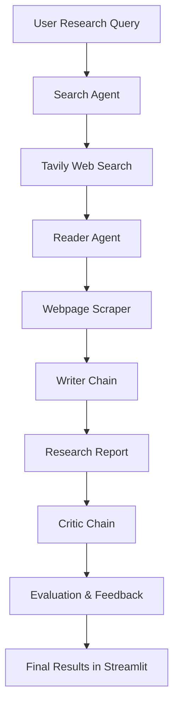

# 🧠 ResearchMind — Multi-Agent AI Research Assistant

<p align="center">
  <strong>An AI-powered research assistant that searches, analyzes, writes, and evaluates research reports using a multi-agent architecture.</strong>
</p>

<p align="center">
  <a href="https://researchmind-multi-agent-system-ad.streamlit.app/">
    
  </a>
  <a href="https://github.com/getcloselyai-ctrl/REASE.AI-Multi-Agent-System">
    
  </a>
</p>

---

## 🚀 Live Demo

### **[Try ResearchMind Now →](https://researchmind-multi-agent-system-ad.streamlit.app/)**

Enter a research topic and let multiple AI agents work together to generate a structured research report.

---

## 📌 Overview

**ResearchMind** is a multi-agent AI research system built with Python, LangChain, Groq, Tavily, and Streamlit.

Instead of relying on a single LLM response, ResearchMind divides the research process into specialized stages. Each agent performs a specific task, creating a sequential workflow that transforms a research query into a structured report.

The system searches for relevant information, reads webpages, generates a research report, and evaluates the final output using a critic agent.

## ✨ Key Features

- **Multi-Agent Architecture:** Specialized agents handle different stages of the research process.
- **Automated Web Search:** Uses Tavily to retrieve relevant web results.
- **Webpage Scraping:** Extracts readable content from webpages using BeautifulSoup.
- **AI-Powered Report Generation:** Produces structured and detailed research reports.
- **AI Critic & Evaluation:** Reviews the generated report, identifies strengths and weaknesses, and provides a score.
- **Interactive Interface:** Built with Streamlit for a clean and user-friendly experience.
- **Report Export:** View and download research output through the application interface.

## 🏗️ System Architecture

ResearchMind follows a sequential multi-agent workflow.



### 🔍 Agent Workflow

| Component | Responsibility |
|---|---|
| Search Agent | Searches the web and collects relevant sources using Tavily. |
| Reader Agent | Reads and extracts useful information from webpages. |
| Writer Chain | Generates a detailed, structured research report. |
| Critic Chain | Evaluates the report and provides a score, strengths, and improvement areas. |

### Research Pipeline

1. **Search:** The Search Agent searches the web for relevant information.
2. **Read:** The Reader Agent processes selected URLs and extracts webpage content.
3. **Write:** The Writer Chain generates a report with an introduction, key findings, conclusion, and sources.
4. **Evaluate:** The Critic Chain reviews the report and provides structured feedback.
5. **Display:** Results are presented in the Streamlit application.

## 🛠️ Tech Stack

| Technology | Purpose |
|---|---|
| Python | Core programming language |
| Streamlit | Interactive web application |
| LangChain | Agent and LLM orchestration |
| Groq | LLM inference |
| GPT-OSS-120B | Language model |
| Tavily | Web search |
| BeautifulSoup | Webpage content extraction |
| Requests | HTTP requests |
| Python-dotenv | Environment variable management |

## 📂 Project Structure

```text
ResearchMind/
│
├── app.py                 # Streamlit application and user interface
├── agents.py              # Search, Reader, Writer and Critic components
├── tools.py               # Tavily search and webpage scraping tools
├── pipeline.py            # Research pipeline orchestration
│
├── requirements.txt       # Project dependencies
├── .env.example           # Environment variable template
├── .gitignore             # Git ignored files
└── README.md              # Project documentation
```

## ⚙️ Installation & Setup

### 1. Clone the Repository

```bash
git clone https://github.com/getcloselyai-ctrl/REASE.AI-Multi-Agent-System.git
```

### 2. Navigate to the Project Directory

```bash
cd REASE.AI-Multi-Agent-System
```

### 3. Create a Virtual Environment

```bash
python -m venv .venv
```

Activate it on Windows:

```powershell
.venv\Scripts\Activate.ps1
```

Activate it on macOS/Linux:

```bash
source .venv/bin/activate
```

### 4. Install Dependencies

```bash
pip install -r requirements.txt
```

### 5. Configure API Keys

Create a `.env` file in the root directory:

```env
GROQ_API_KEY=your_groq_api_key
TAVILY_API_KEY=your_tavily_api_key
```

Get your API keys:

- **Groq API:** https://console.groq.com/keys
- **Tavily API:** https://app.tavily.com/

> Never commit your `.env` file or expose your API keys publicly.

### 6. Run the Application

```bash
python -m streamlit run app.py
```

Open the local application:

```text
http://localhost:8501
```

## ☁️ Deployment

ResearchMind is deployed using **Streamlit Community Cloud**.

To deploy your own instance:

1. Push the project to a GitHub repository.
2. Open https://share.streamlit.io/
3. Connect your GitHub repository.
4. Select `app.py` as the main file.
5. Add the required API keys under **App Settings → Secrets**.

Configure secrets in TOML format:

```toml
GROQ_API_KEY = "your_groq_api_key"
TAVILY_API_KEY = "your_tavily_api_key"
```

6. Deploy the application.

## 🔐 Environment Variables

| Variable | Description |
|---|---|
| `GROQ_API_KEY` | API key used for Groq LLM inference |
| `TAVILY_API_KEY` | API key used for web search |

Both variables are required for the complete research workflow.

## 🧪 Example Research Topics

Try the following topics in the live application:

- Impact of Generative AI on Software Engineering
- Multi-Agent Systems and the Future of Artificial Intelligence
- Retrieval-Augmented Generation (RAG) in Enterprise Applications
- Applications of Machine Learning in Healthcare
- The Evolution of Large Language Models

## ⚠️ Limitations

- Research quality depends on the relevance and reliability of retrieved web sources.
- Some websites may block automated scraping or restrict access to their content.
- AI-generated reports may contain inaccuracies and should be independently verified.
- API availability, usage limits, and rate limits depend on the respective providers.

## 🔮 Future Improvements

- Implement LangGraph for more advanced agent orchestration and state management.
- Add source verification and citation validation.
- Introduce human-in-the-loop review.
- Add persistent research history and database integration.
- Support PDF and additional document ingestion.
- Improve report quality through iterative research and refinement.

## 👨‍💻 Author

**Akshat**

- GitHub: https://github.com/getcloselyai-ctrl

---

<p align="center">
  <strong>Built with Python, LangChain, Groq, Tavily & Streamlit.</strong>
  <br>
  If you find ResearchMind interesting, consider giving the repository a ⭐.
</p>
